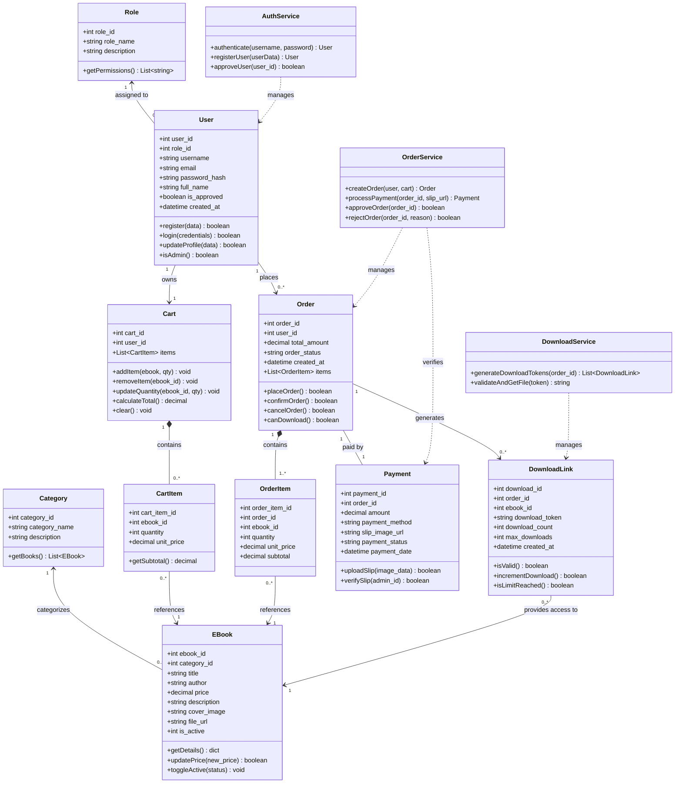
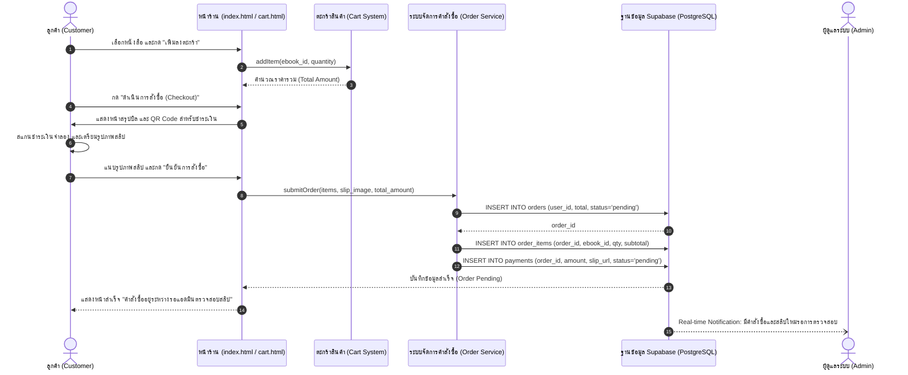
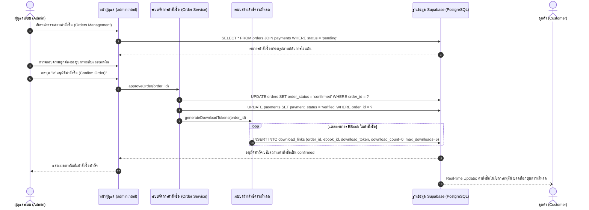
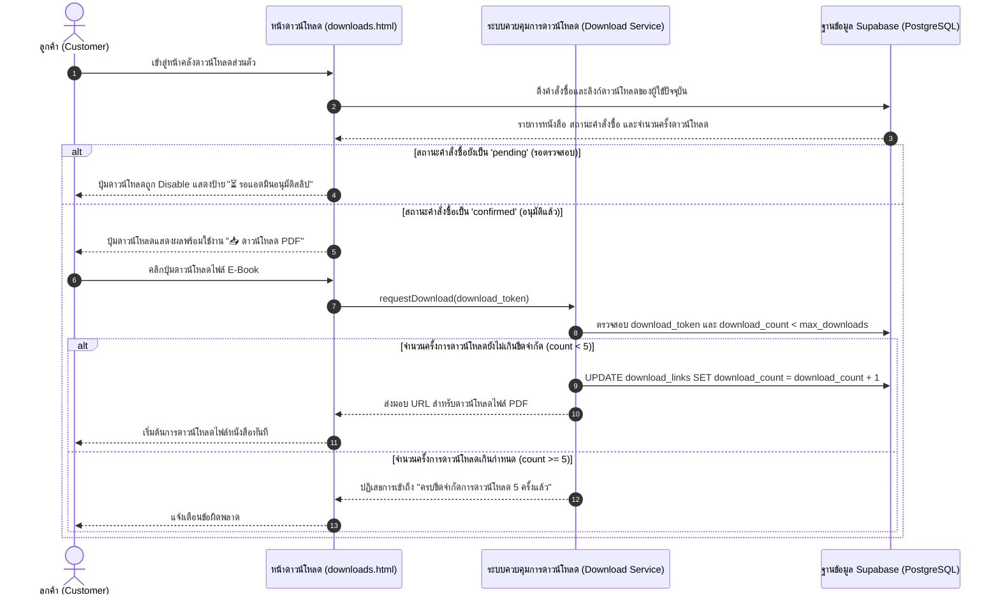

# แผนภาพสถาปัตยกรรมระบบ (System Diagrams): EbookGenZ

เอกสารนี้รวบรวมแผนภาพการออกแบบเชิงโครงสร้างและพฤติกรรมของระบบ **EbookGenZ** ประกอบด้วย **Class Diagram** (โครงสร้างเชิงคลาสและการทำงาน) และ **Sequence Diagram** (ลำดับขั้นตอนการทำงานของระบบ) ตามมาตรฐาน UML เพื่อให้เห็นภาพการทำงานของระบบอย่างชัดเจน

---

## 1. Class Diagram (แผนภาพเชิงคลาส)

Class Diagram แสดงโครงสร้างของระบบในระดับ Domain Models และ Service Layers รวมถึงคุณลักษณะ (Attributes), ฟังก์ชันการทำงาน (Methods) และความสัมพันธ์ระหว่างคลาส (Relationships):

---

## 2. Sequence Diagrams (แผนภาพลำดับขั้นตอนการทำงาน)

### 2.1 แผนภาพลำดับที่ 1: การสั่งซื้อและการแนบสลิปชำระเงิน (Customer Checkout & Slip Upload Flow)
แสดงขั้นตอนที่ลูกค้าเลือกซื้อหนังสือ ชำระเงินผ่าน QR Code จำลอง แนบภาพสลิป และระบบบันทึกข้อมูลเพื่อรอการตรวจสอบจากแอดมิน:

---

### 2.2 แผนภาพลำดับที่ 2: การตรวจสอบสลิปและอนุมัติการสั่งซื้อ (Admin Slip Verification & Order Approval Flow)
แสดงขั้นตอนที่ผู้ดูแลระบบตรวจสอบความถูกต้องของสลิป และกดอนุมัติเพื่อปลดล็อกสิทธิ์ดาวน์โหลดให้ลูกค้า:

---

### 2.3 แผนภาพลำดับที่ 3: การตรวจสอบสิทธิ์และการดาวน์โหลดไฟล์ E-Book (Secure Download Flow)
แสดงกลไกการรักษาความปลอดภัยในระดับข้อมูล โดยระบบจะไม่อนุญาตให้ดาวน์โหลดจนกว่าคำสั่งซื้อจะมีสถานะ `confirmed` เท่านั้น:

---

## 3. สรุปความสอดคล้องกับข้อกำหนดระบบ
* **Class Diagram:** ครอบคลุม Entities ทั้ง 8 ตาราง พร้อม Service Controllers สำหรับ Business Rules ตามข้อกำหนดโครงการ
* **Sequence Diagram:** อธิบายการทำงาน 3 โฟลว์หลักที่แสดงถึงความปลอดภัยในการซื้อขายไฟล์ดิจิทัล การตรวจสอบสลิปของแอดมิน และการควบคุมสิทธิ์ดาวน์โหลดด้วย Token อย่างรัดกุม
